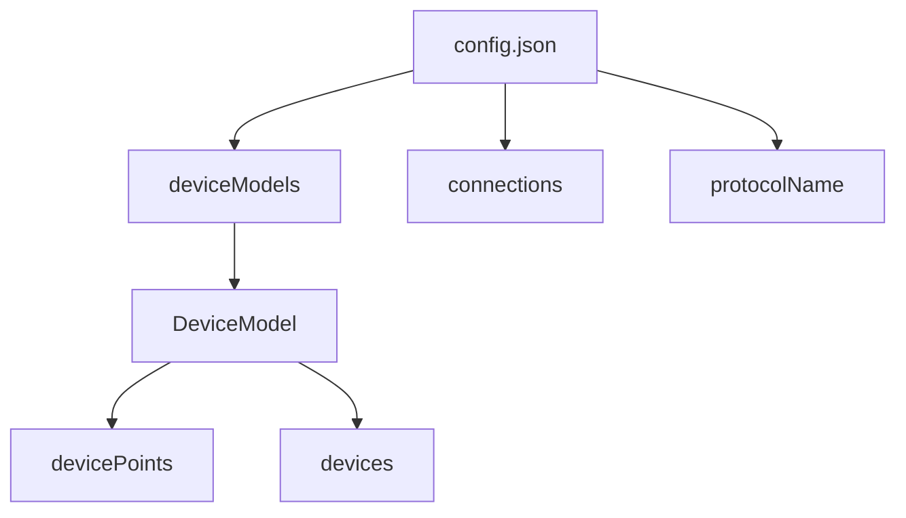

import { Tabs, TabItem } from '@astrojs/starlight/components';

driver-box 采用 JSON 格式进行设备配置，所有配置文件位于 `res/driver/<plugin>/` 目录下。

### 设备配置的用途

设备配置是 driver-box 的核心组成部分，它实现了**设备抽象**和**协议解耦**，使得系统能够：

- **统一设备管理**：通过标准化的 JSON 配置描述不同协议的设备，无需修改代码即可接入新设备
- **协议插件化**：设备配置与协议插件分离，同一设备模型可通过不同协议插件接入（如 Modbus、MQTT）
- **灵活扩展**：通过配置即可定义点位、读写模式、数据转换规则等，满足多样化设备场景
- **云端同步**：支持模型 ID 关联云端设备模型，实现配置与云端的一致性

本文档详细介绍配置文件的结构、各层级参数说明、以及完整的配置示例。

## 快速导航

- [配置文件放置](#配置文件放置)
- [配置层级关系](#配置层级关系)
- [顶层配置](#顶层配置)
- [设备模型（DeviceModel）](#设备模型devicemodel)
- [设备（Device）](#设备device)
- [设备级点位选择](#设备级点位选择)
- [点位（Point）](#点位point)
- [连接配置（connections）](#连接配置connections)
- [协议扩展参数](#协议扩展参数)
- [配置示例](#配置示例)
- [配置验证](#配置验证)

## 配置文件放置

配置文件应放置在对应协议插件的目录下：

```
res/
├── driver/
│   ├── modbus/
│   │   └── config.json
│   ├── mqtt/
│   │   └── config.json
│   └── bacnet/
│       └── config.json
```

### 配置代码结构

配置对应的 Go 结构体定义位于 [pkg/config/device_config.go](https://github.com/orglibs/driver-box/blob/master/pkg/config/device_config.go)

### 配置层级关系



**层级说明**：
- **config.json** - 顶层配置文件
- **deviceModels** - 设备模型数组，定义设备类型和点位
- **connections** - 连接配置，定义设备通讯参数
- **protocolName** - 协议插件名称
- **DeviceModel** - 设备模型，包含点位列表和设备实例
- **devicePoints** - 点位定义数组
- **devices** - 设备实例数组

## 顶层配置

<Tabs>
  <TabItem label="配置结构">
    ### 配置文件结构

    完整的配置文件包含以下结构：

    ```json title="config.json"
    {
      "deviceModels": [
        {
          "name": "模型名称",
          "description": "模型描述",
          "modelId": "云端模型ID",
          "attributes": {},
          "devicePoints": [],
          "devices": []
        }
      ],
      "connections": {},
      "protocolName": "插件名称"
    }
    ```
  </TabItem>

  <TabItem label="配置参数">
    ### 顶层配置参数

    | 参数 | 类型 | 必填 | 说明 |
    |------|------|------|------|
    | deviceModels | array | 是 | 设备模型数组 |
    | connections | object | 是 | 连接配置对象 |
    | protocolName | string | 是 | 协议插件名称（如 `modbus`、`mqtt`） |
  </TabItem>
</Tabs>

## 设备模型（DeviceModel）

配置对应的 Go 结构体定义位于 [pkg/config/device_config_model.go](https://github.com/orglibs/driver-box/blob/master/pkg/config/device_config_model.go)

设备模型定义了一类设备的数据结构和参数，一个模型可以对应多个设备实例。

<Tabs>
  <TabItem label="结构示例">
    ```json
    {
      "name": "温湿度传感器",
      "description": "Modbus温湿度传感器",
      "modelId": "model-001",
      "attributes": {
        "manufacturer": "Example Corp",
        "version": "1.0"
      },
      "devicePoints": [...],
      "devices": [...]
    }
    ```
  </TabItem>

  <TabItem label="参数说明">
    ### 模型配置参数

    | 参数 | 类型 | 必填 | 说明 |
    |------|------|------|------|
    | name | string | 是 | 模型名称（同一配置内唯一） |
    | description | string | 是 | 模型描述 |
    | modelId | string | 是 | 云端模型ID（用于云同步） |
    | attributes | object | 否 | 扩展属性，自定义键值对 |
    | devicePoints | array | 是 | 模型点位定义 |
    | devices | array | 是 | 该模型下的设备实例 |
  </TabItem>
</Tabs>

## 设备（Device）

配置对应的 Go 结构体定义位于 [pkg/config/device_config_device.go](https://github.com/orglibs/driver-box/blob/master/pkg/config/device_config_device.go)

设备是设备模型的具体实例，一个模型可以对应多个设备。

<Tabs>
  <TabItem label="结构示例">
    ```json
    {
      "id": "device-001",
      "description": "会议室传感器",
      "connectionKey": "modbus-tcp-01",
      "properties": {
        "unitID": "1"
      },
      "driverKey": ""
    }
    ```
  </TabItem>

  <TabItem label="参数说明">
    ### 设备配置参数

    | 参数 | 类型 | 必填 | 说明 |
    |------|------|------|------|
    | id | string | 是 | 设备唯一标识符（全局唯一） |
    | description | string | 是 | 设备描述 |
    | connectionKey | string | 是 | 关联的连接配置键（对应 `connections` 中的键名） |
    | properties | object | 否 | 设备属性（协议相关，如 Modbus 的 `unitID`），类型为 `map[string]string` |
    | driverKey | string | 否 | 设备层驱动引用 |
    | pointSelection | object | 否 | 设备级点位选择；省略时使用模型全部点位，详见下节 |
  </TabItem>
</Tabs>

### 设备级点位选择

此能力位于未发布的设备级点位选择改动中，需要使用包含该实现的构建。`pointSelection` 配置在每个设备上，模型的 `devicePoints` 仍由设备共享，不需要复制模型。
以下示例为 `devices[]` 中的一项，假定所属模型已定义 `temperature` 和 `humidity` 两个点位。

```json
{
  "id": "device-001",
  "description": "会议室传感器",
  "connectionKey": "modbus-tcp-01",
  "properties": {"unitID": "1"},
  "pointSelection": {
    "mode": "selected",
    "names": ["temperature", "humidity"]
  }
}
```

`names` 使用所属模型的 `devicePoints[].name`，精确匹配并区分大小写。列表顺序不会重排模型点位。

| 配置 | 启用范围 |
| --- | --- |
| 新配置省略 `pointSelection` | 完整模型点表，保留原有范围和顺序 |
| `{"mode":"all"}` | 完整模型点表，模型新增点位后自动包含 |
| `{"mode":"selected","names":["temperature"]}` | 仅启用所列点位，模型新增点位不会自动包含 |
| `{"mode":"selected","names":[]}` | 零点位，保留设备身份，不回退为完整模型 |

`selected` 必须提供 `names` 数组，省略或 `null` 均不合法；未知、重复、空白或歧义点名会被拒绝。`pointSelection: null` 不合法；`all` 不接受非空 `names`。
点位启用后仍须符合 `readWrite` 权限。批量读写请求中包含未启用点时，整批在物理发送前拒绝；原始请求在 Lua 编码前检查，编码后的点位再次检查。

当前 Modbus（含反向）、DL/T645、IEC104、BACnet、OPC UA 和 S7 的采集/监视使用设备有效点表。主动读写与设备点位列表同样遵循选择，TCP Server 等推送结果通过公共导出流程过滤。

`selected` 设备的 Lua 驱动加载或解码失败时，不写入新的 Shadow 点值、不触发 `Exporting` 点值事件，也不调用 `ExportTo`；原始 `DoExport` 诊断事件保留。省略选择或使用 `all` 时保持原有异常处理路径。

对已有 `Device` 做 JSON 局部更新时，未提供的字段和已有 `pointSelection` 会保留，`properties` 按原来的 map 规则合并。显式提供选择对象时整体替换；恢复全部点位请提供 `{"mode":"all"}`，不能用省略字段来清除已有选择。

更新选择后需要按现有流程重建插件连接/采集任务或重启；不提供在途任务取消、历史 Shadow 清理或已启动任务的立即重分组。
选择限制逻辑点位，并不保证批量请求不经过未选点的物理地址。Modbus 地址避让需结合 [只写与批量读取配置](/driver-box/plugins/modbus/#只写点位)。
应用查询设备有效点表应使用 [CoreCache.GetDevicePoints](/driver-box/concepts/corecache/#设备有效点表)，模型完整定义仍通过 `GetPoints` 获取。

## 点位（Point）

点位是设备模型中的最小数据单元，用于定义采集和控制的参数。

配置对应的 Go 结构体和方法定义位于 [pkg/config/device_config_model_point.go](https://github.com/orglibs/driver-box/blob/master/pkg/config/device_config_model_point.go)

<Tabs>
  <TabItem label="结构示例">
    ```json
    {
      "name": "temperature",
      "description": "温度",
      "valueType": "float",
      "readWrite": "R",
      "reportMode": "realTime",
      "scale": 0.1,
      "decimals": 1,
      "units": "℃"
    }
    ```
  </TabItem>

  <TabItem label="参数说明">
    ### 基础点位参数

    | 参数 | 类型 | 必填 | 说明 |
    |------|------|------|------|
    | name | string | 是 | 点位名称（模型内唯一） |
    | description | string | 否 | 点位描述 |
    | valueType | string | 是 | 数据类型：`int`（整数）、`float`（浮点数）、`string`（字符串）。driver-box只支持这三种数据类型，已能够涵盖所有设备场景。 |
    | readWrite | string | 是 | 读写权限：`R`（只读）、`W`（只写）、`RW`（读写） |
    | reportMode | string | 否 | 上报模式：`realTime`（实时上报，读到数据即触发导出）、`change`（变化上报，与影子中值不一致才触发） |
    | scale | number | 否 | 缩放因子（用于数值转换） |
    | offset | number | 否 | 工程值偏移，默认 0；读取先乘 scale 再加 offset，写入先减 offset 再除 scale |
    | decimals | number | 否 | 小数位数保留 |
    | units | string | 否 | 单位 |
    | enums | array | 否 | 枚举值数组，用于界面展示和值映射，包含`name`（枚举名称）、`value`（枚举值）、`icon`（枚举图标，可选） |

    ### 数值偏移与读写换算

    `offset` 表示工程单位下的值偏移，不是寄存器地址偏移。它允许正数、负数和小数；缺省为 0。显式 `null`、字符串（包括 `"10"`）、布尔、数组、对象和非有限数值均不合法。

    未使用 Lua 设备驱动时，内置换算顺序为：

    ```text
    读取：工程值 = 原始值 × scale + offset，再按 decimals 处理小数精度
    写入：原始值 = (工程值 − offset) ÷ scale，再由协议编码
    ```

    为兼容既有配置，`scale` 缺省或为 0 时表示不缩放，计算中使用系数 1。`offset` 缺省或为 0 时保留原有数值转换和协议取整行为，不额外将整数转成浮点数。

    非零 `offset` 仅用于 `valueType: "int"` 或 `"float"` 的数值点；String、布尔、Modbus 线圈/离散输入和位提取点只允许缺省或数值 0。启用非零偏移时，`scale` 也必须是合法有限数值。偏移参数按 float64 表示；运算过程保留整数输入的精度，最终浮点工程值仍受 float64 精度限制。

    工程值可能有小数时使用 `valueType: "float"`，原始寄存器仍可为整数。启用非零偏移且 `valueType: "int"` 时，完整换算后的工程值必须是合法 int64 整数；写入整数 rawType 时，逆向换算后的原始值必须是整数且在其类型范围内，否则返回错误，不自动四舍五入。浮点 rawType 允许小数，但拒绝溢出和非有限结果。单点与批量写入采用相同规则，换算失败时不发送本次写请求。

    采样换算错误只跳过出错点位，不用原始值或伪造值覆盖 Shadow，其他合法点位继续导出；变化过滤使用换算后的工程值。通过 `driverbox.WritePoint`/`WritePoints` 写入工程值，框架在交给协议前逆向换算；直接调用协议 `Encode` 时仍应传入协议侧原始值，不重复换算。

    配置 `device.driverKey` 启用 Lua 设备驱动后，scale 和 offset 的读写运算均交给脚本，不会再自动叠加；脚本需要自行保证正反换算一致。`offset` 的字段类型和适用点位约束仍有效。

    ### 枚举配置示例

    ```json
    {
      "name": "switch",
      "description": "开关状态",
      "valueType": "int",
      "readWrite": "RW",
      "enums": [
        {"name": "关闭", "value": 0, "icon": "off"},
        {"name": "开启", "value": 1, "icon": "on"}
      ]
    }
    ```
  </TabItem>
</Tabs>

## 连接配置（connections）

连接配置定义了与设备通讯的参数，具体格式由协议插件决定。多个设备可以共用同一个连接配置。

### 通用连接结构

```json
{
  "connections": {
    "connection-name": {
      // 协议特定参数
    }
  }
}
```

各协议插件的连接配置参数请参考对应的插件文档：
- [Modbus 插件](/driver-box/plugins/modbus/#连接配置)
- [MQTT 插件](/driver-box/plugins/mqtt/#连接配置)
- [BACnet 插件](/driver-box/plugins/bacnet/#连接配置)
- [DL/T 645 插件](/driver-box/plugins/dlt645/#连接配置)

## 协议扩展参数

协议插件可以在点位中添加扩展参数，用于定义协议特定的配置。这些扩展参数直接定义在点位对象中，无需嵌套在 `properties` 字段。

### Modbus 扩展示例

```json
{
  "name": "temperature",
  "startAddress": "40001",
  "primaryTable": "HOLDING_REGISTER",
  "rawType": "Float32",
  "duration": "5s",
  "byteSwap": false,
  "wordSwap": false
}
```

### MQTT 扩展示例

```json
{
  "name": "temperature",
  "topic": "device/temperature",
  "qos": 1,
  "retain": false
}
```

**注意**：不同协议插件的扩展参数不同，具体请参考对应插件的文档。

## 配置示例

<details>
  <summary>点击查看完整的配置示例</summary>

以下是一个完整的 Modbus 设备配置示例，包含协议特定扩展参数（如 `startAddress`、`primaryTable` 等）：

```json
{
  "deviceModels": [
    {
      "name": "温湿度传感器",
      "description": "Modbus温湿度传感器",
      "modelId": "modbus-001",
      "attributes": {
        "manufacturer": "Example",
        "version": "1.0"
      },
      "devicePoints": [
        {
          "name": "temperature",
          "description": "温度",
          "valueType": "float",
          "readWrite": "R",
          "reportMode": "realTime",
          "scale": 0.1,
          "decimals": 1,
          "units": "℃",
          "startAddress": "40001",
          "primaryTable": "HOLDING_REGISTER",
          "rawType": "Float32",
          "duration": "5s"
        },
        {
          "name": "humidity",
          "description": "湿度",
          "valueType": "float",
          "readWrite": "R",
          "scale": 0.1,
          "decimals": 1,
          "units": "%",
          "startAddress": "40002",
          "primaryTable": "HOLDING_REGISTER",
          "rawType": "Float32",
          "duration": "5s"
        }
      ],
      "devices": [
        {
          "id": "sensor-001",
          "description": "会议室传感器",
          "connectionKey": "modbus-tcp-01",
          "properties": {
            "unitID": "1"
          }
        }
      ]
    }
  ],
  "connections": {
    "modbus-tcp-01": {
      "address": "192.168.1.100:502",
      "mode": "tcp",
      "timeout": 5000,
      "retry": 3,
      "minInterval": 100
    }
  },
  "protocolName": "modbus"
}
```
</details>

## 配置验证

创建配置文件后，建议进行以下检查：

1. **JSON 语法验证**：使用在线 JSON 验证工具
2. **必需字段检查**：确保所有标记为"必填"的字段都已填写
3. **引用完整性**：确保 `connectionKey` 在 `connections` 中存在
4. **设备 ID 唯一性**：确保设备 ID 全局唯一

